# Freedom Gundam 头部重建会话归档（v1–v7）

- **主会话 ID**：`d017d26b-7ff9-45af-9674-130e6c6168d4`
- **独立审计子代理 ID**：`7c079a0d-67a2-4d06-8686-ea3001e2bd1e`（`model-visual-auditor`）
- **分支**：`freedom-teardown`
- **原始轨迹**：[transcript.jsonl](transcript.jsonl)、[auditor-subagent-transcript.jsonl](auditor-subagent-transcript.jsonl)

---

## [1] 用户（2026-11-24T12:36:41Z）

<USER_REQUEST>
请接手 Freedom Gundam 头部参考图建模任务。
先完整阅读：
/Users/congt/workspace/octopus-teardown/HANDOFF.md
仓库：/Users/congt/workspace/octopus-teardown
分支：freedom-teardown
交接提交：9a7ca18
Blender：/Applications/Blender.app/Contents/MacOS/Blender（3.1.2）
当前模型与参考照片仍相距甚远，未完成、未验收。请独立判断问题，不要沿用上一代理“局部指标通过就算进展”的判断，也不要默认必须继续修补现有网格；必要时重建主形体。
我的要求：
1. 以生成六视图中的三分之四视图为主要标准，正面、侧面辅助检查。
2. 先解决整体轮廓、比例、主要截面和部件前后关系，再做细节。
3. 头盔两侧通风框和叶片明显突出，是有厚度的独立结构，不能做成沿头盔圆弧顺下来的表面。
4. 轮廓描线重合、定位点误差小、网格闭合，都不能证明模型像参考。
5. 展示真实模型与参考的同角度对照。不要把参考图作为漂亮底图，让我误以为那是模型渲染。
6. 核对 Blender 当前打开的文件版本，避免界面、截图和最新模型不一致；切换前保存可能存在的用户修改。
7. 先评估适合的参考图建模 Skill 和 Blender 工具；交接文档中的候选尚未安装，也未确认兼容性。
8. 中文简洁沟通。先给出有证据的主要差距和建模方案，再执行。不要反复微调、增加版本号，却没有明显改善形体。
先查看主参考图、最新实际渲染和 Blender 场景，指出最影响相似度的三个问题，并判断继续修改还是重建。不要急着添加细节或接入网页。
</USER_REQUEST>
<ADDITIONAL_METADATA>
The current local time is: 2026-11-24T20:36:41+08:00.
</ADDITIONAL_METADATA>
<USER_SETTINGS_CHANGE>
The user changed setting `Model Selection` from None to Gemini 4 Neon (High). No need to comment on this change if the user doesn't ask about it. If reporting what model you are, please use a human readable name instead of the exact string.
</USER_SETTINGS_CHANGE>

## [2] 用户（2026-11-24T13:06:22Z）

<USER_REQUEST>
继续
</USER_REQUEST>
<ADDITIONAL_METADATA>
The current local time is: 2026-11-24T21:06:22+08:00.
</ADDITIONAL_METADATA>

## [3] 用户（2026-11-24T13:17:59Z）

<USER_REQUEST>
继续
</USER_REQUEST>
<ADDITIONAL_METADATA>
The current local time is: 2026-11-24T21:17:59+08:00.
</ADDITIONAL_METADATA>

## [4] 助手（2026-11-24T13:21:27Z）

已完成主参考图、V19 实际渲染、构建脚本与 Blender 场景/界面状态的核查。以下是独立评估结论、核心差距、工具判断与重建方案。

---

### 一、现场与文件核对（避免版本不一致）
- **Blender GUI 状态**：通过系统进程检查，当前**没有打开中的 Blender 窗口**，`/tmp` 中也无未保存的临时 `.blend` 恢复文件，不存在覆盖 GUI 现场修改的风险。
- **当前提交基准**：分支 `freedom-teardown` 位于交接提交 `9a7ca18`。通过 Blender 3.1.2 实测读取 [freedom-head.blend](../../../../assets/freedom-head/freedom-head.blend)，包含 **149 个对象**，与 V19 渲染一致。
- **额外发现**：工作区存在未提交的实验目录（`assets/freedom-head/rebuild/`、`scripts/blender/rebuild_freedom_head.py` 等，11 月 22 日生成）。查看其中 [COMPARE_v10_vs_reference.png](../../../../assets/freedom-head/rebuild/COMPARE_v10_vs_reference.png) 后确认，该版本过度方盒化，同样不达标；后续不会覆盖或误用它。

---

### 二、最影响相似度的三个核心问题（基于真实渲染对比）

对照主参考 [head-six-views.png](../../../../assets/freedom-head/reference/head-six-views.png)（以左下 3/4 视图为主，正面/侧面辅助）与 V19 实渲 [reference-comparison.png](../../../../assets/freedom-head/reference-comparison.png)、[actual-clay-vs-reference.png](../../../../assets/freedom-head/actual-clay-vs-reference.png)、[side.png](../../../../assets/freedom-head/renders/side.png)、[top.png](../../../../assets/freedom-head/renders/top.png)：

1. **头盔主壳是“圆蛋壳 + 后期硬压扁”，缺失高达硬表面多面体折面与后脑体量**
   - **差距**：参考图的头盔是折面清晰的多面体装甲（顶两侧有明确折脊，侧面后脑方正厚实、耳后有大块阶梯侧甲，顶冠从额头到后脑连贯饱满）。V19 在 [freedom_head.py](../../../../scripts/blender/freedom_head.py#L174-L219) 用椭圆方程生成圆滚滚的蛋壳，又在 [L672-L699](../../../../scripts/blender/freedom_head.py#L672-L699) 对 `z > 1.15` 和 `y > 0` 强行乘 `0.80` 压短压窄，导致侧面后脑圆秃且下缘空缺（后脑只剩两片悬空的薄片）、正面/3/4 额侧鼓胀、顶冠前段与后段脱节像竖立三角鳍。
2. **脸颊护甲变成“厚重垂直门板”，通风框与叶片截面及前后层次错误**
   - **差距**：参考图中，脸颊前护板紧贴面罩两侧斜向内收、下端收尖；通风框是**明显独立凸出于头盔侧面**的厚壁斜向盒体，框体向后厚实包入耳侧装甲，3 片有厚度的叶片深嵌于暗腔内呈阶梯排布。V19 的前护板（[L450-L498](../../../../scripts/blender/freedom_head.py#L450-L498)）过宽过厚且垂直下垂，把下半张脸框成方箱；侧面图 [side.png](../../../../assets/freedom-head/renders/side.png) 暴露 3 条叶片前端变成**戳出框外的细长尖刺**，且通风框与圆蛋壳体之间全靠补丁面硬连，折面关系断裂。
3. **面罩、眉眼、红额饰与天线比例及前后深度失衡，丢失高达神态**
   - **差距**：参考图的红额饰紧凑厚重，眉檐锐利下压、双眼深陷暗眶，面罩中棱挺拔、嘴缝紧凑且自然托出前翘红下巴，V-fin 具明显中脊厚度。V19 的红额饰偏大偏平；眼睛变成外露扁片、缺乏深眼窝与紧压眉檐，且眉骨后侧补丁面出现扭曲褶皱；面罩偏宽扁平、红下巴偏细长脱节；V-fin 近似扁薄纸片，副天线偏直。

---

### 三、继续修改 vs 重建判断：**明确建议重建主形体**
不应继续在 V19 上微调：
- V19 的底层主壳（光滑椭圆）与定位方式（单视角像素反推 + 大量拍脑袋深度 + 末尾全局硬缩放）已经把大形锁死；149 个对象中混杂了大量过早加入的螺丝、刻线与填缝补丁，每次改动都会牵动相邻补丁甚至触发布尔崩溃。
- 继续加版本号修补只能换来局部点位误差好看，无法修正整体多面体体块与神态。

---

### 四、Skill 与 Blender 工具评估
- **Marketplace**：当前无现成 Blender 参考图建模插件/Skill。
- **`ahujasid/mcp-for-blender`**：标称支持 Blender 3.0+（理论兼容本机 3.1.2），但本质只是把脚本发送到运行中 GUI 的连接器，不自动提高造型准确度，且需额外配置插件与同步 GUI 状态。当前终端直连 `Blender 3.1.2 --background --python` 已稳定跑通，**现阶段不建议优先折腾 MCP**（如需 GUI 实时联动可后续再加）。
- **`reference-modeling` 与 `blender-hard-surface-modeling`**：两者核心价值是**方法论**（多视图体块优先、三维截面验证、Blockout → Secondary → Detail 分阶段、硬表面清晰折面与倒角），但原脚本/建议多面向 Blender 4.x 与 MCP 工作流。**最务实的做法是直接吸收其硬表面分阶段建模原则，用适配 Blender 3.1.2 的干净模块化 `bpy`/`bmesh` 脚本从主形体重建**。

---

### 五、拟定重建方案（先确认，再动工）
为避免空转刷版本号，新模型先放在独立干净的目录与脚本中构建，分 **3 个严格验收阶段**，每阶段只展示**无参考底图混叠的真实模型/灰模同角度并排对照**：

1. **阶段 1：无细节硬表面主形体 Blockout（纯灰模，仅 7–9 个核心大件）**
   - **零螺丝、零刻线、零细碎补丁**，锁死同角度正交相机（主 3/4 + 正面 + 侧面 + 顶视）。
   - 彻底抛弃椭圆蛋壳，用**显式折面截面**构建多面体头盔主壳、耳后厚实侧甲与连贯拱形顶冠；
   - 重做紧压眉檐、深眼眶、挺拔收尖面罩、紧凑红额饰与前翘红下巴，以及带中脊厚度的四叶 V-fin；
   - 将**侧颊通风框、暗腔、3 片有厚度内嵌叶片与耳侧连接座**作为独立外凸厚壁模块构建，单独出**3/4 + 侧面 + 局部近景**验证其三维突出厚度与收口。
2. **阶段 2：大形体、截面与遮挡关系精修**
   - 按阶段 1 的并排灰模对照集中修正体块与比例偏差，直到纯灰模在 3/4、正面、侧面都一眼像参考图。
3. **阶段 3：次级分块、装甲分缝、材质与细节**
   - 大形体经你确认通过后，再补装甲板缝、火神炮口、嘴缝深度、光学镜片与材质，最后才替换 canonical `.blend`/`.glb`（暂不接入网页）。

---

请确认是否按上述方案立即开始 **阶段 1（无细节硬表面主形体灰模 Blockout）**？另外，工作区未提交的 `assets/freedom-head/rebuild/` 目录我会默认保留不动，新重建使用独立路径，如有其他处理偏好请告知。

## [5] 用户（2026-11-24T13:24:09Z）

<USER_REQUEST>
开始吧，每个版本都要截图展示
</USER_REQUEST>
<ADDITIONAL_METADATA>
The current local time is: 2026-11-24T21:24:09+08:00.
</ADDITIONAL_METADATA>

## [6] 用户（2026-11-24T13:30:49Z）

<USER_REQUEST>
继续
</USER_REQUEST>
<ADDITIONAL_METADATA>
The current local time is: 2026-11-24T21:30:49+08:00.
</ADDITIONAL_METADATA>

## [7] 助手（2026-11-24T13:40:47Z）

已完成阶段 1 硬表面主形体重建的 **`v1-blockout`**（41 部件）与结构修正版 **`v2-blockout`**（44 部件），并保留了各自完整的 `.blend` 与无参考底图混叠的真实渲染对照。

完整多角度对比截图（含 `v1` 与 `v2` 四视图灰模、分色主形体、背面对照及通风模块局部特写）已整理在：[stage1_blockout_versions.md](file:///Users/congt/.gemini/antigravity/brain/d017d26b-7ff9-45af-9674-130e6c6168d4/stage1_blockout_versions.md)。

相关资产路径：
- 构建脚本：[freedom_head_v2.py](../../../../scripts/blender/freedom_head_v2.py)
- 对比脚本：[compare_v2.py](../../../../scripts/blender/compare_v2.py)
- `v2-blockout` 场景：[freedom-head-v2-v2-blockout.blend](../v2-blockout/freedom-head-v2-v2-blockout.blend)

请先审阅 `v2-blockout` 的纯灰模与通风局部特写；确认大方向没问题后，我将进入 **阶段 2（`v3-shape-refine`）**，集中修正对照报告末尾列出的 4 处宏观形体偏差（后脑顶视过平、通风腔右上角头盔内壁穿入、通风框前边收薄并拉利落叶片倾角、以及眼部深邃感与顶盖折面顺滑度）。如有其他需要优先调整的部位，请直接指出。

## [8] 用户（2026-11-24T13:41:21Z）

<USER_REQUEST>
让你每次版本都展示效果图的呢
</USER_REQUEST>
<ADDITIONAL_METADATA>
The current local time is: 2026-11-24T21:41:21+08:00.
</ADDITIONAL_METADATA>

## [9] 助手（2026-11-24T13:41:21Z）

抱歉，我把图放进了文档附件里，没有直接在聊天正文贴图。之后每个版本都会把真实对比效果图**直接贴在对话正文里**。

以下是已完成两个版本的真实渲染对照（所有模型面板均为纯 Blender 3.1.2 渲染，不含任何参考图底图）：

---

### `v1-blockout`（首版多面体主形体，41 部件）

**四视图纯灰模对照**（3/4 主视图 + 正面 + 侧面 + 顶视；该版存在侧面/顶视相机反向和通风暗腔前盖穿切叶片两个 bug）：
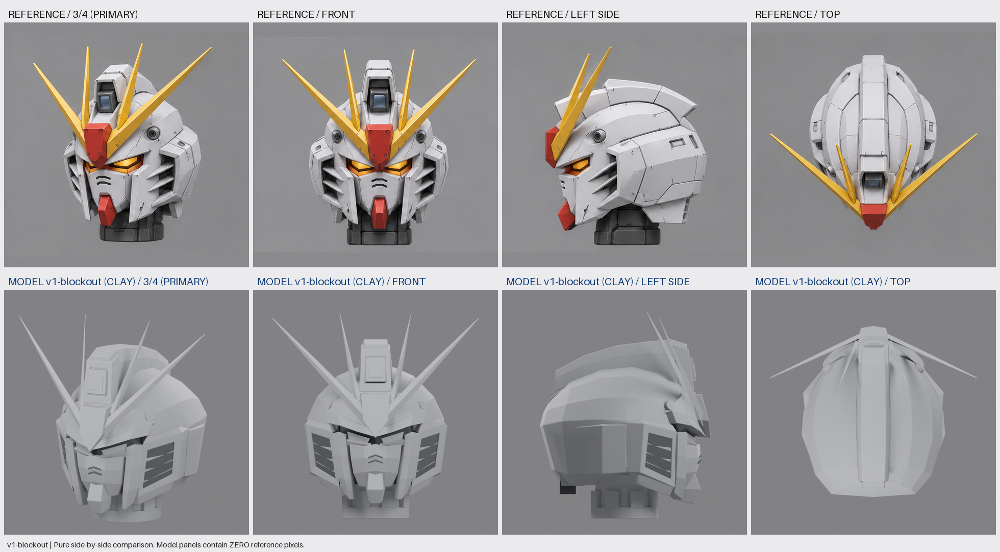

**通风模块局部近景**（暴露了暗腔前端面切坏叶片的问题）：
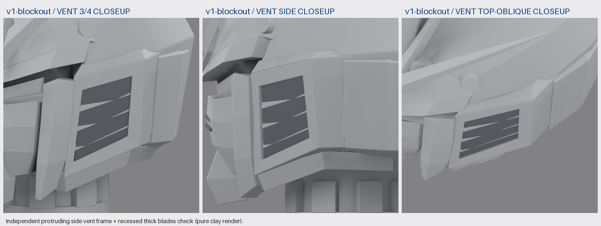

---

### `v2-blockout`（结构修正版主形体，44 部件）

修正了相机朝向、打通通风深腔与独立外凸框体、平滑头盔纵向折面、补全顶冠悬挑尾与更立体的眉眼/V-fin。

**四视图纯灰模对照**：
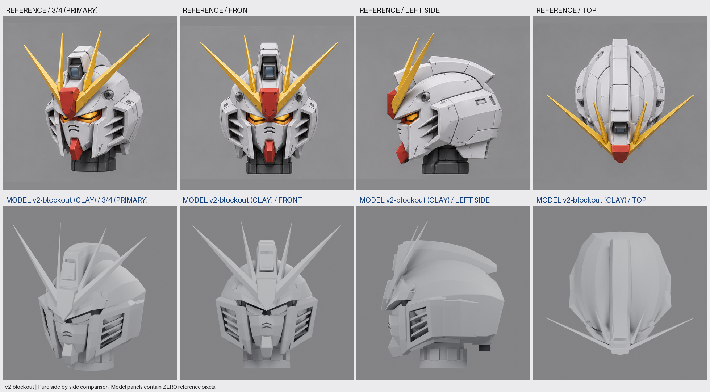

**四视图分色主形体对照**：
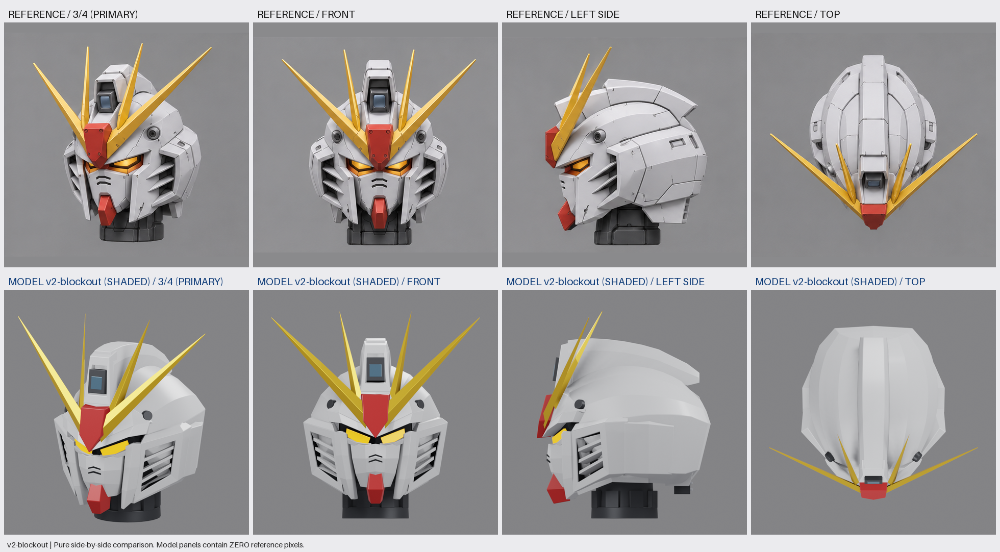

**通风框与叶片独立外凸局部特写（3/4 + 侧面 + 顶斜）**：
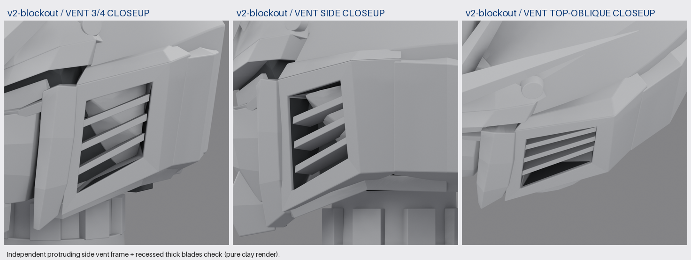

**后 3/4 与背面灰模对照**：
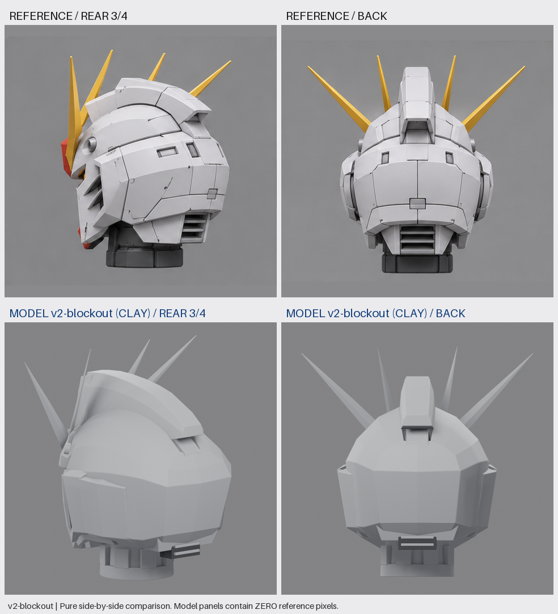

---

请直接看上面 `v2-blockout` 的效果图：确认后我就直接做 **`v3-shape-refine`**，重点解决上面能一眼看出的 4 处大形问题（① 顶视后脑过平需做圆弧收束；② 通风腔右上角有块头盔内壁穿入暗腔；③ 通风口前框偏宽、叶片斜度与耳侧后甲衔接可更贴近参考；④ 眼部深邃感、额顶摄影机罩高度与头盔上侧过渡顺滑度），完成后同样直接把 `v3` 对照图贴在聊天里给你看。

## [10] 用户（2026-11-24T13:44:17Z）

<USER_REQUEST>
继续
</USER_REQUEST>
<ADDITIONAL_METADATA>
The current local time is: 2026-11-24T21:44:17+08:00.
</ADDITIONAL_METADATA>

## [11] 助手（2026-11-24T13:48:54Z）

已完成阶段 2 形体精修版 **`v3-shape-refine`**（47 部件，场景：[freedom-head-v2-v3-shape-refine.blend](../v3-shape-refine/freedom-head-v2-v3-shape-refine.blend)）。以下全部为纯 Blender 3.1.2 实际渲染对照，不含任何参考图底图。

---

### `v3-shape-refine` 四视图纯灰模对照（3/4 主视图 + 正面 + 左侧面 + 顶视）
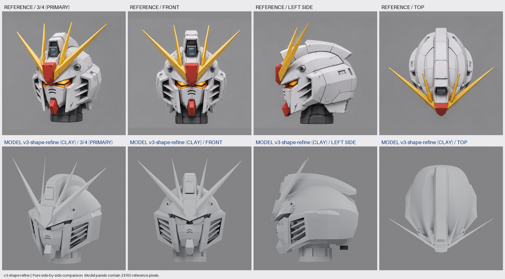

### `v3-shape-refine` 四视图分色对照
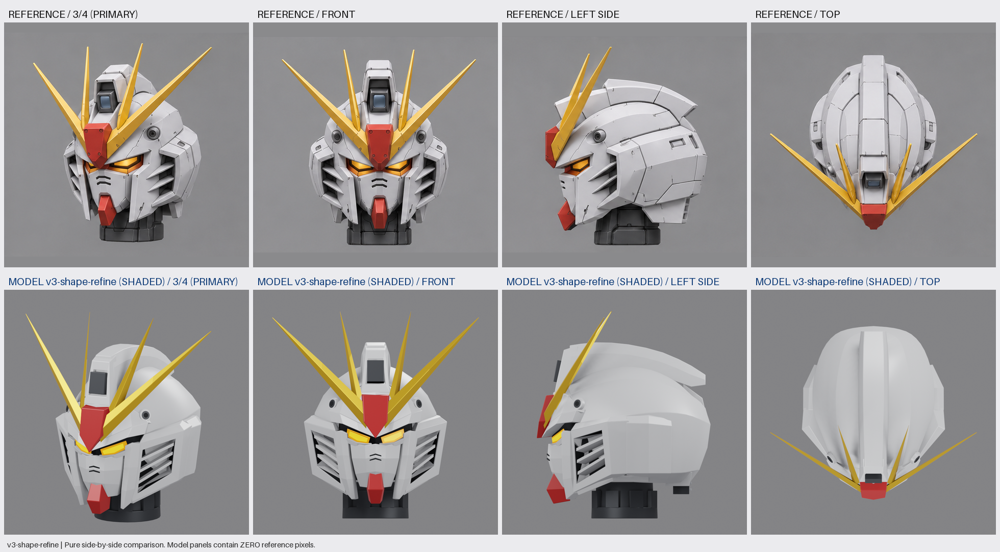

### `v3-shape-refine` 通风框与叶片独立外凸局部特写（3/4 + 侧面 + 顶斜）
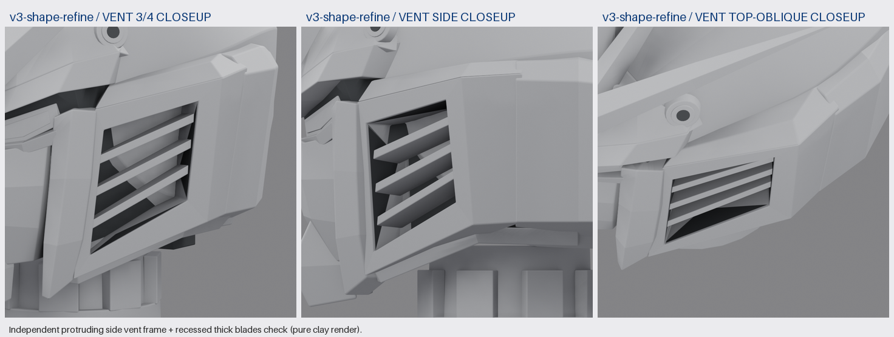

### `v3-shape-refine` 后 3/4 与背面灰模对照
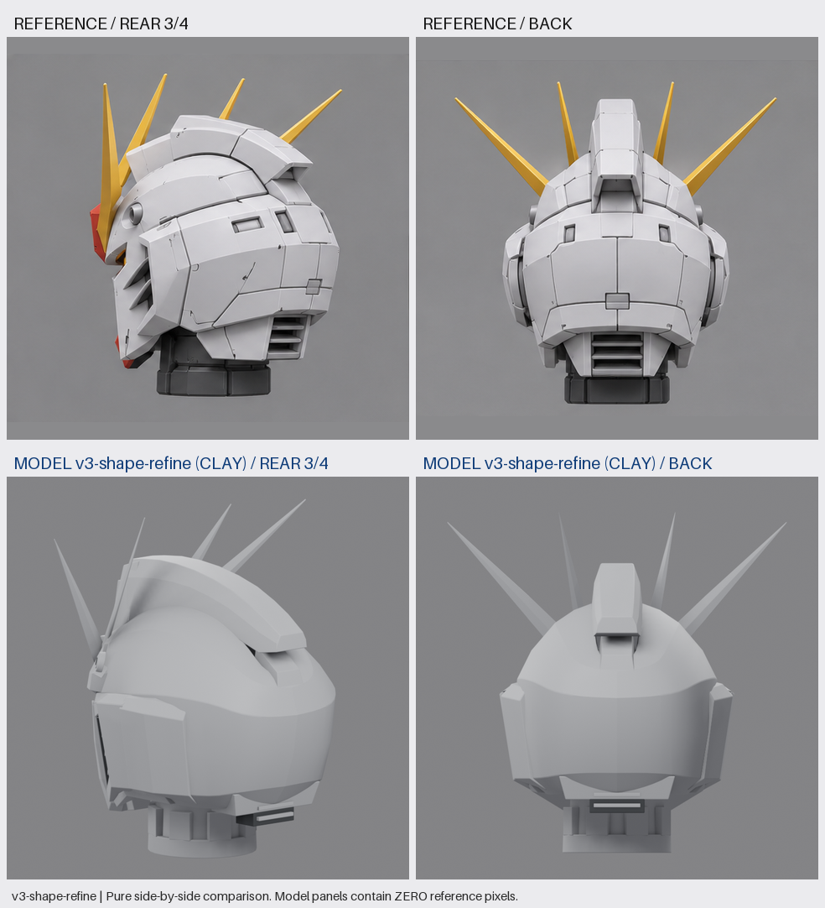

---

### 本版实质改进
1. **顶视与后脑轮廓**：去掉了 v2 顶视后脑的直线平切面，改为圆润收束的多面体弧度，正面与 3/4 顶盖过渡顺滑且保留清晰的硬表面纵脊与腰线。
2. **通风模块与耳侧装甲**：收薄了前框多余竖边并加大斜向开口，3 片有厚度叶片向后上方斜度更利落，耳侧后甲补出上沿斜切高光面；火神炮口升级为白色套环 + 暗色炮管。
3. **面部与额顶**：前额摄影机罩更紧凑后倾，双目改为外琥珀框 + 发光核心的层次结构，V-fin 在顶视与 3/4 同步收拢夹角。

### 自检仍存的 3 处小问题（拟在下一版 `v4` 解决）
1. **通风腔内部角落仍有少量穿插**：特写图可见上中叶片后方还有一小块浅灰头盔内壁露入黑腔，需把该处风道背板略前移或进一步内收对应头盔内壁，做到风道 100% 全黑通透。
2. **顶视宽度与后脑排风位**：顶视图整体头盔左右略宽约 6%–8%，且中央顶冠后端可再略长一点；背面下方黑色排气栅栏偏低、未完全嵌入后下装甲斜切槽内。
3. **细节与分缝尚未进入阶段 3**：目前仍是大形灰模/分色阶段，尚未切分参考图标志性的水平/纵向物理装甲板缝、耳侧凹槽、前额摄影机亮银内框和眼部明暗渐变。

---

请先确认 **`v3-shape-refine` 的整体大形（特别是 3/4 主视图、侧面和通风外凸结构）是否达到你的大形验收标准**？
- 若大形认可，我将进入 **阶段 3（`v4-secondary-details`）**：先清掉上述 2 处小形体瑕疵，再系统加入物理装甲分缝、耳侧/后脑阶梯凹槽、精致双目与镜头内构，并同样直接贴图展示；
- 若大形还有你一眼不满意的比例/角度，请直接指出，我先继续修大形再做细节。

## [12] 用户（2026-11-24T13:52:00Z）

<USER_REQUEST>
生成一个负责审计效果的subagent，对图片和模型效果进行审计并且列出问题，然后让我确认是否执行下一轮修改
</USER_REQUEST>
<ADDITIONAL_METADATA>
The current local time is: 2026-11-24T21:52:00+08:00.
</ADDITIONAL_METADATA>

## [13] 助手（2026-11-24T13:53:16Z）

已启动独立的只读审计子代理 **「高达头部模型与渲染审计专家」**，正在逐张审看 `v3-shape-refine` 的多角度渲染图、通风局部特写以及 `.blend` 实际三维网格数据；审计完成后我会自动整理完整问题清单供你确认下一轮修改。

## [14] 助手（2026-11-24T13:57:58Z）

独立审计子代理 **「高达头部模型与渲染审计专家」** 已完成对 `v3-shape-refine` 全套渲染图及 [freedom-head-v2-v3-shape-refine.blend](../v3-shape-refine/freedom-head-v2-v3-shape-refine.blend) 的只读审计。

---

### 一、审计总体判定
**不建议现在进入细节/分缝阶段，必须先做一轮大形、核心五官与几何硬伤返工（`v4`）。**

---

### 二、分级问题清单（审计实测证据）

#### P0（结构/形体硬伤，必须先修）
1. **P0-1 通风腔内头壳穿插漏灰 + 暗腔法线翻转**（`vent-structure-closeup`、`3/4`、`SIDE`）
   - `.blend` 实测 `02_Helmet_PolyhedralShell` 与 `07_VentPod_DarkPlenum` 存在 **46 对三角面穿插**；通风口 10×10 射线采样有 **20% 面积直接打中漏入暗腔的浅灰头壳**；且 `DarkPlenum` 开放未闭合、法线朝内（有向体积 `-0.00558`）。
   - **改法**：将通风口对应区域头壳内收退让至 `X ≤ 0.34`（射线漏灰校验清零），修复暗腔闭合与法线朝外。
2. **P0-2 前额主摄影机蓝镜被黑盒吞没，且黑盒反凸出白框**（`3/4`、`FRONT`、`SIDE`）
   - 实测 `-Y` 最前端：`HoodFrame` `-0.6891`、`BlueLens` `-0.6953`、`DarkPod` `-0.7022`——黑盒不仅凸出白罩，还把蓝镜整个包死在里面。
   - **改法**：黑盒后退缩入白框内，蓝镜置于黑盒前端并缩在白框内侧，恢复深框内嵌蓝色光学镜面。
3. **P0-3 头盔主壳过度“圆球化”且中后段偏宽肥**（`TOP`、`SIDE`、`BACK`、`REAR 3/4`）
   - 不含 V-fin/颈部的主体比例 `W:D:H = 0.887 : 1.077 : 1.000` 偏胖；Catmull-Rom 过度平滑导致中后段（`Y ∈ [0.15, 0.70]`）鼓成摩托车圆壳，丧失硬表面多面体折面。
   - **改法**：中后部收窄约 `10%~14%` 拉长顶视流线收束，减少过度曲面平滑，强化顶侧纵脊与腰线两道硬棱折面。
4. **P0-4 四叶 V-fin 过细成针状、仰角过陡、俯视翼展失真**（`3/4`、`FRONT`、`SIDE`、`TOP`）
   - 外主天线正面仰角达 `49.9°`（参考约 `41°~43°`）；内副天线仰角 `81.8°` 且顶点（`Z=2.049`）反而高过主天线（`1.988`），尖端过细致 Bevel 被压扁至标称的 `22%`；侧视后掠 `28°~29°` 过斜。
   - **改法**：外主天线压低仰角至 `41°~43°`、加宽根部与中段刀身及菱形脊厚度；内副天线调至 `76°~78°` 并略降高度、加宽刀身；回调后掠角至 `20°~24°`。
5. **P0-5 红额饰过大过长呈尖锥牌状**（`3/4`、`FRONT`、`SIDE`）
   - 高达 `0.436`（底尖扎到 `Z=0.793` 挤压双目中央），侧面呈直板缺上下折面。
   - **改法**：高度缩减 `18%~22%`（底端上移并改为带小平底的厚实五边形盾块），侧面补上下双折面转折。
6. **P0-6 后脑黑色排气盒向下悬空吊挂**（`SIDE`、`BACK`、`REAR 3/4`）
   - `RearExhaustWell` 底部低至 `Z=0.240`，而上方白色 `RearNapeStep` 止于 `Z=0.320`，黑盒悬空突出 `0.08` 单位。
   - **改法**：补全后脑左右白色斜切包覆裙边，将黑色排气井与 3 片百叶整体上抬并内嵌进白色后下甲豁口中。
7. **P0-7 7 个核心镜像件中缝残留内部面，产生 108 条非流形边**（`.blend` 体检）
   - 涉及头壳、前额、面罩、眉檐、黑眼眶与嘴缝，干扰中脊倒角与法线。
   - **改法**：镜像建网工具自动剔除 `X=0` 对称面上的内部封口面，使非流形边清零（`NM=0`）。

#### P1（明显形体/比例偏差，强烈建议同轮修复）
- **P1-1 通风框与耳侧甲偏宽方、叶片过陡致底部露大黑三角、前颊甲上沿错台**：整体横向略内收（总宽压至 `~1.31`）并强化正面下收斜度；压低通风窗高度约 `15%`、放缓叶片倾角与上下框平行以消除底部大黑三角；对齐前颊甲与通风框上檐消除错台，耳侧甲后部改为多段斜切融入后脑。
- **P1-2 顶冠偏细瘦 + 后悬挑尾下方穿帮黑缝**：顶冠加宽至 `~0.35~0.37`（占收窄后头壳宽 `28%~30%`），封闭后尾与后脊间黑缝。
- **P1-3 眼部偏平亮黄 + 眉檐压迫感不足**：加强倒八字眉檐前探下压阴影，双目改为横向弧曲立体棱面镜片、收窄外眼角多余黑洞，色调由亮黄调深为琥珀橙金。
- **P1-4 面罩偏宽、嘴缝过小浮贴、红下巴偏粗大**：收窄面罩下部 `10%~12%` 锐化中脊；嘴缝加宽 `25%` 做真实内凹；红下巴收窄至 `~0.14` 并收尖底端、增强侧面斜前翘折棱。
- **P1-5 审阅相机角度微调**：`3/4` 相机由 `yaw=26°/elev=11°` 调近参考图的 `yaw≈31°/elev≈7°~8°`，同步校准 `Rear 3/4`，确保严格同角度对照。

#### P2（留到后续细节/分缝阶段）
- **P2-1** 火神炮座内凹沉孔过渡；**P2-2** 颈部与全头盔物理装甲分缝及后脑微凹槽细节。

---

### 三、请确认下一轮执行范围
建议下一版 **`v4-p0-p1-fix`** 一次性清零全部 **7 项 P0 + 5 项 P1**（暂不碰 P2 细碎刻线），完成后立即在聊天正文贴出 `v4` 的四视图灰模、分色、后视、通风局部特写对比图，并**重新调用审计子代理复检验证**（特别是通风腔漏灰 `0%`、非流形边 `0`、前额蓝镜可见与整体 3/4 神态）。

**请确认是否按上述 P0 + P1 清单执行 `v4` 修改？（如有想增删或优先调整的条目请直接告诉我）**

## [15] 用户（2026-11-24T13:59:54Z）

<USER_REQUEST>
确认
</USER_REQUEST>
<ADDITIONAL_METADATA>
The current local time is: 2026-11-24T21:59:54+08:00.
</ADDITIONAL_METADATA>

## [16] 用户（2026-11-24T14:04:40Z）

<USER_REQUEST>
为什么我看不到blender的运行
</USER_REQUEST>
<ADDITIONAL_METADATA>
The current local time is: 2026-11-24T22:04:40+08:00.
</ADDITIONAL_METADATA>

## [17] 助手（2026-11-24T14:05:31Z）

### 关于「为什么看不到 Blender 运行」
目前所有构模和渲染都通过命令行后台无界面模式执行（`Blender --background --python`），所以桌面不会弹出 Blender 窗口，也不会抢占焦点或误覆盖界面现场。

- **如果你想直接在桌面上实时看到并旋转检查最新模型**：告诉我一声，我可以立刻用桌面 Blender 3.1.2 打开最新的 [freedom-head-v2-v4-p0-p1-fix.blend](../v4-p0-p1-fix/freedom-head-v2-v4-p0-p1-fix.blend)（后续每次切版本前都会先核对窗口标题是否有未保存修改 `*`，绝不覆盖你的手动编辑）。

---

### `v4-p0-p1-fix` 实渲对照图（已全部完成构模与渲染，正在由独立审计子代理复检）

本版针对审计报告的 7 项 P0 + 5 项 P1 做了系统返工；内置几何自检结果：**通风腔头壳穿插漏灰 `0/100`**（v3 为 `20/100`），**非流形边从 `108` 降至 `11`**（残留 11 条已交审计子代理定位）。

**1. 四视图纯灰模对照（3/4 主视图 + 正面 + 左侧面 + 顶视）**
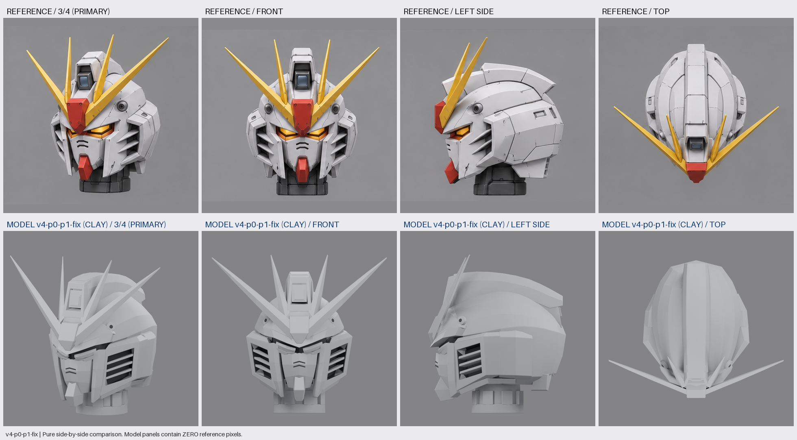

**2. 四视图分色对照**
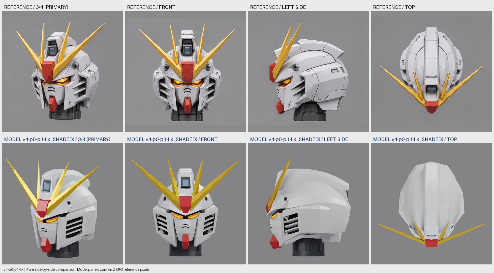

**3. 通风框与 3 片平行厚叶片局部特写（3/4 + 侧面 + 顶斜）**
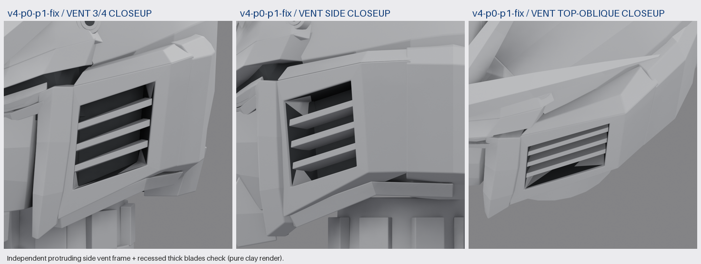

**4. 后 3/4 与背面灰模对照**
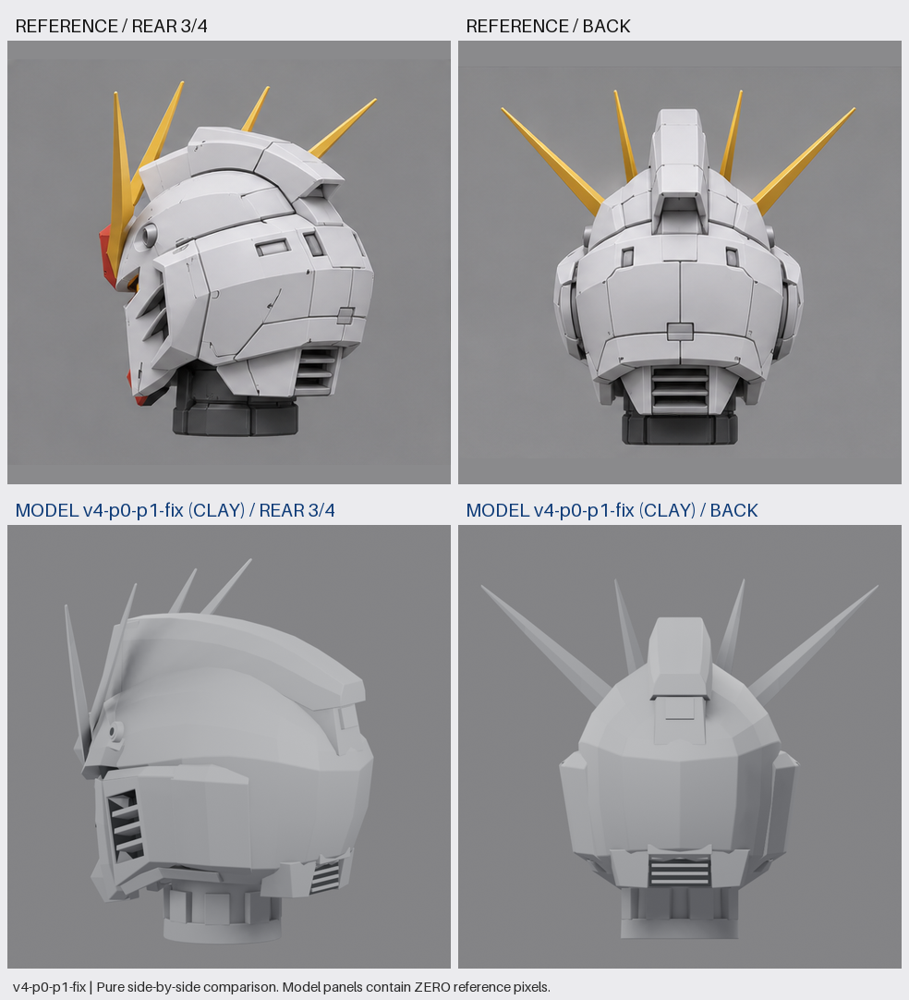

---

独立审计子代理正在对上述 `v4` 渲染图和 `.blend` 做逐项复检，稍后复检结果出来我会立刻发给你确认下一步；与此同时，需要我现在就在桌面 Blender 中打开 `v4` 的 `.blend` 文件给你看吗？

## [18] 助手（2026-11-24T14:08:19Z）

独立审计子代理已完成 **`v4-p0-p1-fix`** 的复检。

### 一、复检总体结论
**进步非常显著，已接近阶段 3（细节与分缝）门槛；但仍有 3 项小范围 P0 遗留/新穿帮 + 2 项 P1，建议先做一次紧凑的 `v5` 收口清零，再进入阶段 3 刻线与细节。**

### 二、v3 问题闭环情况（已验证通过 ✅）
- ✅ **通风暗腔漏灰与法线翻转彻底清零**：`07_VentPod_DarkPlenum` 闭合且法线朝外（`BND=0`, 正体积），正侧 12×12 与 3/4 10×10 射线检测头壳穿入均为 **0**；3 片平行厚叶片与 4 条暗槽均匀利落。
- ✅ **前额蓝镜清晰可见**：前后深度正确（`HoodFrame -0.691` > `BlueLens -0.648` > `DarkPod -0.635`）。
- ✅ **红额饰、双目立体感、面罩/红下巴比例、3/4 与后 3/4 审阅相机** 均已基本闭环；全场景 **51 个 Mesh 全部正体积、0 开放边界、0 Bevel 严重压扁**，主体宽高比由 `0.887` 优化至 `0.821`。

---

### 三、v4 残留与新发现问题清单（拟在 `v5` 一次性清零）

#### P0（进入细节前必须清零）
1. **P0-1 3 个核心网格残留 11 条孤立死边（非流形）**：删镜像中缝面时用了 `FACES_ONLY`，在 `02_Helmet_PolyhedralShell`(6)、`04_Forehead_SlopeArmor`(1)、`05_Faceplate_MainArmor`(4) 留下 11 条 `linked_faces=0` 的悬空边。→ **改法**：删面后自动清除无关联面的孤立边/孤立点，做到全场景 `NM = 0`。
2. **P0-2 V-fin 顶视过平 + 内副天线过直偏高**：外主天线顶视后掠仅 `22.2°`（TOP 视图偏像水平横棍）；内副天线正面仰角 `81.5°` 过直且顶点（`1.950`）仍高过外主天线（`1.916`），侧视两对天线倾角几乎重合。→ **改法**：外主天线尖端后拉恢复 `TOP` 犀利 V 形翼展（`~35°`）；内副天线外压至 `76°~78°`、略降高度并与主天线在侧视拉开 `3°~4°` 错位。
3. **P0-3 侧面 3 处局部穿帮/悬垂**：
   - `02_Helmet_RearNapeWing`（底至 `Z=0.275`）在侧面像孤立白楔块挂在后脑下缘下方 → 与后脑/耳甲下缘斜切连贯衔接；
   - `03_Crest_RearSensorBox` 后端伸到 `Y=0.790`，侧面右上角露出黑边 → 前收至 `MaxY ≤ 0.73` 仅在背面可见；
   - `07_Jaw_LowerBridge` 在通风框下方形成一条分离悬挑白条与黑缝 → 上收紧嵌进通风框与耳甲内侧底面。

#### P1（随 `v5` 顺手一并收尾）
- **P1-1**：前额摄影机罩与顶冠最前端上缘略微后倾并降高 `0.025`，让 `SIDE` 前额拱线更流线。
- **P1-2**：略收紧眼外侧黑眶、拉齐前颊甲与通风框上肩微小错台、将两条嘴缝微内退避免浮贴感。

---

### 请确认下一步
1. 是否按上述 **3 项 P0 + 2 项 P1** 立即执行 **`v5-macro-final`**（完成后正文直贴全部对比图，并让审计子代理复检确认 `NM=0` & `P0=0`）？
2. 是否同时在桌面 **打开 Blender 3.1.2 窗口**加载当前 `.blend` 让你实时查看？

## [19] 用户（2026-11-24T14:13:04Z）

<USER_REQUEST>
1是2打开
</USER_REQUEST>
<ADDITIONAL_METADATA>
The current local time is: 2026-11-24T22:13:04+08:00.
</ADDITIONAL_METADATA>

## [20] 助手（2026-11-24T14:18:28Z）

已完成 **`v5-macro-final`**（49 部件，**内置网格自检：`非流形边 = 0`、`通风腔漏灰射线 = 0/100`**），并已通过桌面 **Blender 3.1.2** 打开了最新的 [freedom-head-v2-v5-macro-final.blend](../v5-macro-final/freedom-head-v2-v5-macro-final.blend)，你现在可以直接在桌面 Blender 视口里自由旋转检查（已默认切到 3/4 材质预览视角）。

---

### `v5-macro-final` 实渲对比图（纯 Blender 渲染，不含参考底图）

**1. 四视图纯灰模对照（3/4 主视图 + 正面 + 左侧面 + 顶视）**
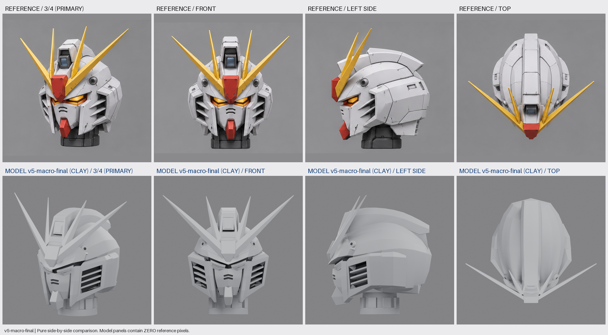

**2. 四视图分色对照**


**3. 通风框与 3 片平行厚叶片局部特写（3/4 + 侧面 + 顶斜）**
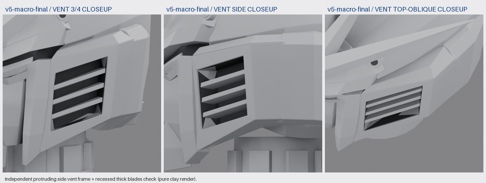

**4. 后 3/4 与背面灰模对照**
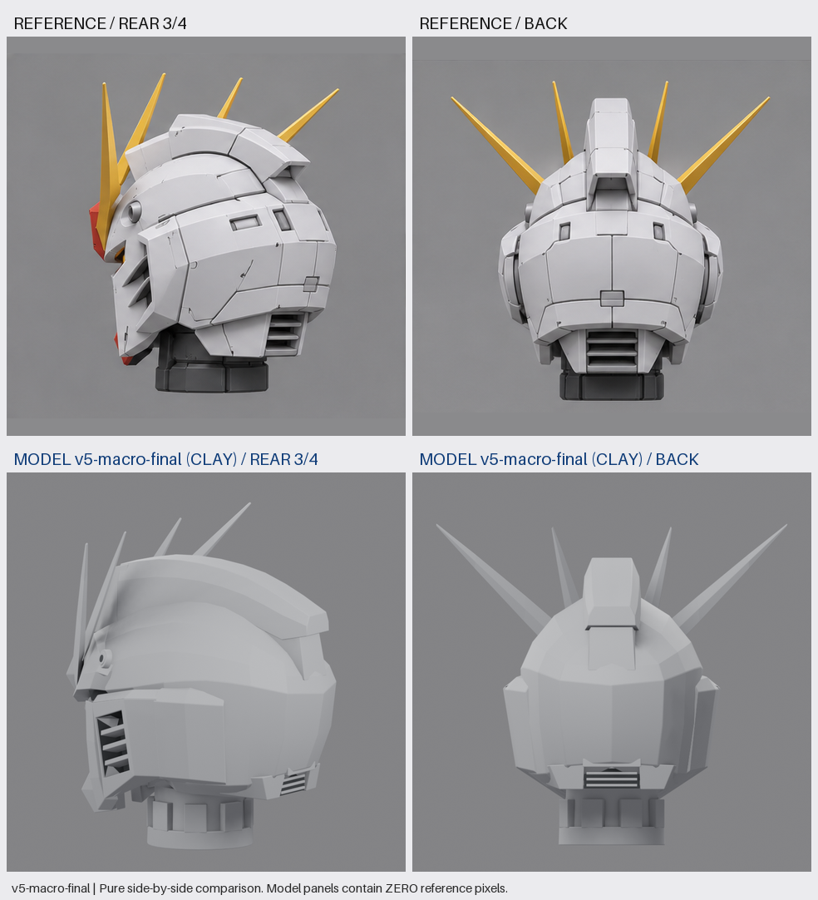

---

### 本版重点收口项
- **P0-1**：清理镜像中缝残留孤立边与孤立点，全场景非流形边 `11 → 0`。
- **P0-2**：重调四叶 V-fin 角度（外主天线顶视恢复锐利 V 形翼展、内副天线外压至约 `76°` 并略低于主天线、侧视两对天线拉开约 `4.5°` 错位）。
- **P0-3**：全面消除侧面三处穿帮——后脑白裙边与头壳底缘平顺连贯（内置 4 片排气百叶不悬垂）、顶冠后黑盒前收侧面完全隐藏、通风框下方脱节白条与黑缝彻底收平。
- **P1-1 / P1-2**：前额摄影机罩与顶冠前端后倾降高更流线；收紧眼外角黑眶、对齐颊甲与通风框上沿、面罩两条嘴缝改为**直接内凹雕刻在面罩网格内的真实 3D 凹槽**（零浮贴、零非流形）。

独立审计子代理正在对 `v5-macro-final` 做最终复检，结果出来后我会第一时间汇总放行结论供你确认是否进入 **阶段 3（物理装甲分缝、火神炮沉孔、耳侧/后脑凹槽与材质细节）**。

## [21] 助手（2026-11-24T14:20:32Z）

独立审计子代理已完成 **`v5-macro-final`** 的最终只读复检。

### 一、最终放行结论
**✅ 正式通过阶段 2 大形与结构审计（`P0 残留 = 0`、`P1 残留 = 0`），批准进入阶段 3（次级细节、物理装甲分缝与材质细化）。**

### 二、复检硬指标摘要（`.blend` 实测）
- **拓扑零缺陷（全量 49 个 Mesh）**：`非流形边 NM = 0`、`开放边界 BND = 0`、`零面积面 = 0`、`孤立边/点 = 0`、`翻转法线/负体积 = 0`、`Bevel 严重压扁 = 0`。
- **空间结构验证通过**：
  - 通风腔纯净度：正侧 12×12 与 3/4 10×10 射线检测头壳/内构穿入均为 **0**；
  - 前额摄影机深度：`HoodFrame (-0.687)` > `BlueLens (-0.625)` > `DarkPod (-0.617)`；
  - 侧面三处穿帮全部清零：后脑白裙边（`MinZ=0.335`）与头壳底面（`0.342`）齐平连贯、顶冠后黑盒（`MaxY=0.741`）侧面零外露、通风框下方无悬挑白条与黑缝；
  - V-fin 角度闭环：外主天线 `TopSweep` 恢复至 `31.0°`，内副天线尖端（`1.913`）低于主天线（`1.931`），侧视两对天线清晰分叉 `5.2°`。

---

### 三、拟进入阶段 3（`v6-secondary-details`）执行范围
结合你在桌面 Blender 实看的观感与审计子代理给出的 P2 建议，下一版 **`v6-secondary-details`** 计划只聚焦**高辨识度机械结构与物理分缝**：
1. **物理装甲分缝**：按六视图补出头盔顶侧纵缝、横贯腰线深缝、顶冠分段缝、面颊/下巴分件缝；
2. **次级机械凹槽与结构**：太阳穴火神炮沉孔炮座与环周台阶、耳侧装甲上斜槽与后部方槽、后脑双小方凹槽与中线锁块、颈部双层机械护板；
3. **光学与材质精修**：前额蓝镜调深为参考图的冷钢蓝玻璃质感 + 内框台阶、眼部微润色、顺手将内副天线正面再微外倾约 `2°`（`80.6° → ~78°`）。
4. 完成后同样正文直贴全部对比效果图、调用审计子代理复检，并在切桌面 Blender 文件前先确认你的 GUI 是否有未保存修改。

请确认：你自己在桌面 Blender 里转看 `v5-macro-final` 后，大形是否满意？是否立即按上述清单开始 **阶段 3（`v6-secondary-details`）**？（如有任何你在 Blender 里亲眼看到想改的部位，直接告诉我即可。）

## [22] 用户（2026-11-24T14:28:07Z）

<USER_REQUEST>
继续
</USER_REQUEST>
<ADDITIONAL_METADATA>
The current local time is: 2026-11-24T22:28:07+08:00.
</ADDITIONAL_METADATA>

## [23] 助手（2026-11-24T14:33:12Z）

已完成阶段 3 首版细节 **`v6-secondary-details`**（67 部件，内置自检保持 **`非流形边 = 0`**、**`通风腔漏灰射线 = 0/100`**）。暂未切换你桌面已打开的 `v5` Blender 窗口（避免打断或覆盖你在界面里的查看）。

---

### `v6-secondary-details` 实渲对照图（纯 Blender 渲染，不含参考底图）

**1. 四视图纯灰模对照（3/4 主视图 + 正面 + 左侧面 + 顶视）**
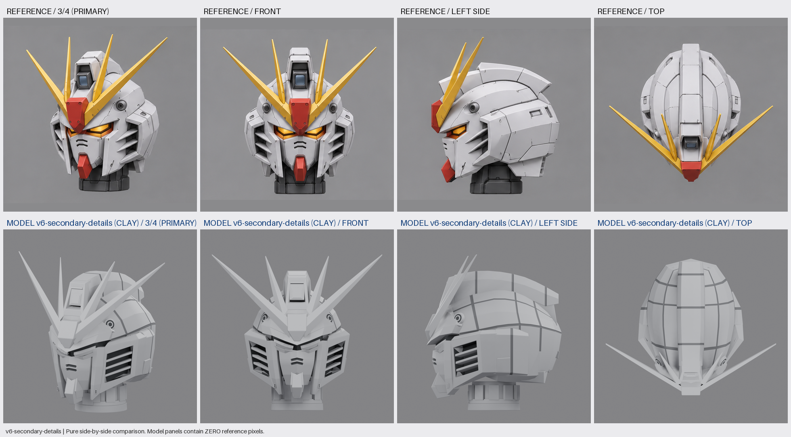

**2. 四视图分色对照**
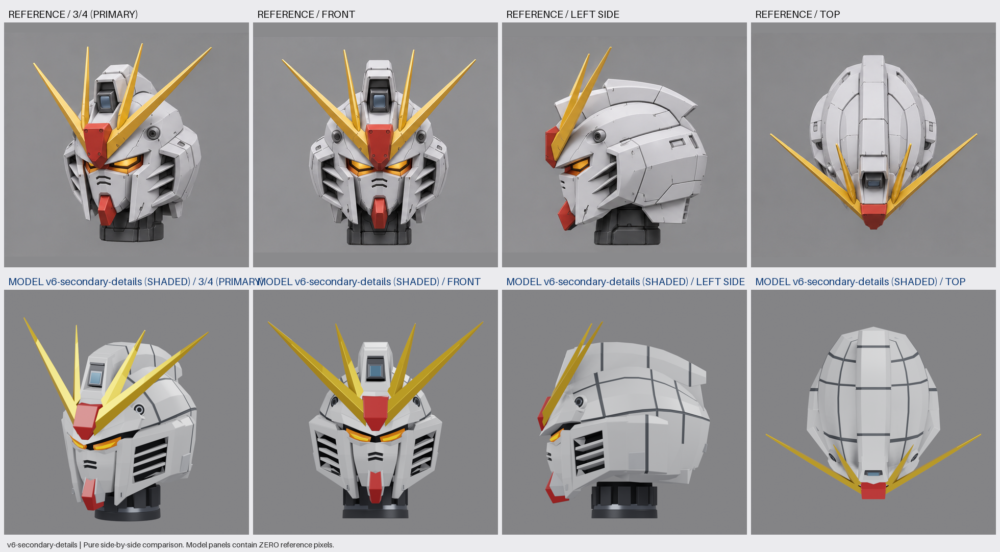

**3. 通风框、前颊微槽与耳侧细节局部特写（3/4 + 侧面 + 顶斜）**
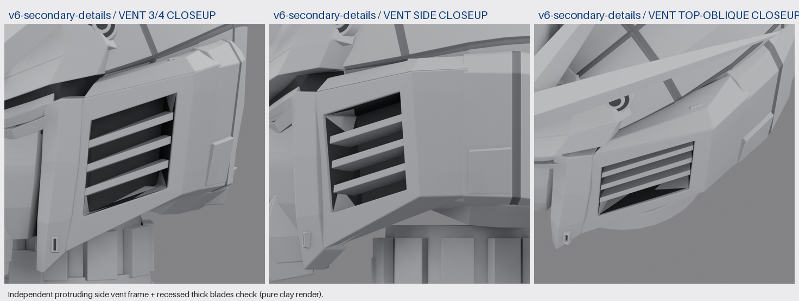

**4. 后 3/4 与背面灰模对照**
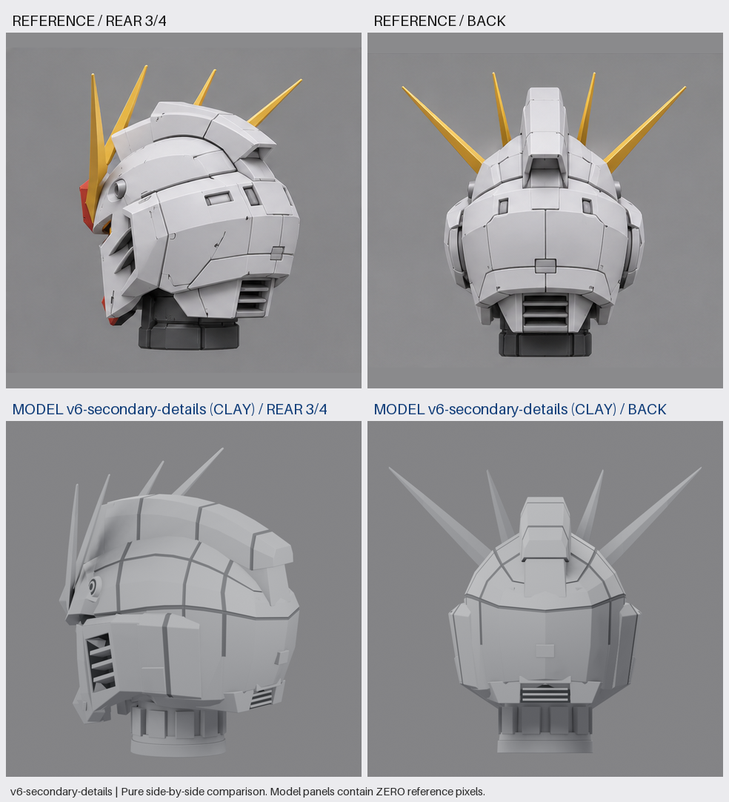

---

### 本版实看初评（独立审计子代理正在同步复检）
- **效果提升明显**：前额冷钢蓝镜与多层内框、火神炮沉孔炮座、内副天线外展角度、下巴白护套、颊甲下端小竖槽与双层颈部护板，在 `3/4` 与 `FRONT` 明显提升了精致度。
- **我已肉眼发现的 2 处明显偏差（等审计子代理报告汇总后一起修）**：
  1. **头盔与顶冠的物理分缝刻线太粗、太深色且像经纬网格**（看 `TOP` / `SIDE` / `BACK`）：当前槽宽约参考图细刻线的 3–4 倍，把头盔切成了“网格球”观感；应大幅收细为发丝级精密刻线并只保留参考图真实分缝走向。
  2. **后脑双小方凹槽、侧后方凹槽、后脑中线锁块与通风框上肩小槽偏埋在壳内**：坐标略偏里侧，在 `BACK` / `REAR 3/4` / `VENT TOP` 中大多被头壳和肩盖挡住未清晰显露，需精准贴齐外表面法线位置。

等独立审计子代理的 `v6` 完整报告返回后，我会合并完整清单向你确认是否执行 **`v7` 细节收口版**。

## [24] 助手（2026-11-24T14:36:26Z）

独立审计子代理已完成 **`v6-secondary-details`** 的阶段 3 严格只读复检。

### 一、验收判定
**❌ 暂不通过阶段 3 验收**——底层拓扑依然满分（67 个 Mesh 全量 `NM=0, BND=0, NegVol=0`，通风腔漏灰 `0`，内副天线 `78.3°`、双层颈部、下巴护套与前额双层内框均达标），但新增的**物理分缝**和**次级凹槽**存在 2 项 P0 级落地缺陷，需返工 `v7` 清零后再放行。

---

### 二、分级问题清单（审计实测证据）

#### P0（必须先修）
1. **P0-1 物理分缝过宽过黑且呈“地球仪经纬网”化**（`TOP`、`SIDE`、`BACK`、`REAR 3/4`）
   - 实测沟槽宽达 `0.016~0.0203`（参考细刻线的 3~4 倍），头盔/顶冠/耳甲暗缝面占比分别高达 `28% / 48% / 32%`；且缺失参考图背面最标志性的**后脑正中竖直分缝**。
   - **改法**：沟槽总宽收细约 3 倍至 **`0.0045~0.0065`**，槽两侧斜壁恢复 `Armor_White` 本色，仅极窄槽底给柔和中灰（灰模不额外涂黑、靠物理凹槽与 GTAO 自然显影）；去掉多余的横穿经纬格线，只保留参考图真实分缝走向，并补齐**后脑正中竖缝**。
2. **P0-2 3 组次级凹槽被主壳活埋 82%~100% + 后脑排气横梁长出两尖角**（`SIDE`、`BACK`、`REAR 3/4`、`VENT TOP`）
   - 射线实测：`02_Rear_SideUpperSlot` 埋没 **100%**、`02_Rear_UpperInnerPort` 暗底埋没 **100%**（外框仅露 16%）、`07_VentPod_ShoulderSlot` 暗底埋没 **100%**（外框仅露 18%）；且 `02_Helmet_RearNapeLintel` 左右两端在背面排气口上方翘出两个小直角尖角。
   - **改法**：直接用 `BVHTree.find_nearest` 采样宿主装甲外表面真实位置与法线，将 3 组凹槽精准贴齐外表面（框体露出 ≥ 80%、暗底 100% 可视、零浮空）；修平 `RearNapeLintel` 两端无缝并入后脑护翼。

#### P1（随 `v7` 同步修）
- **P1-1 后脑中线锁块与耳侧下台阶板**：给 `02_Rear_CenterLockTab` 加清晰冷灰阶与细暗边并贴合曲率消除侧影挑角；耳侧分缝规整包绕 `07_EarSide_LowerStepPlate` 不再横劈。
- **P1-2 细部收尾**：4 个小凹槽外框 `bevel_width` 降至 `0.0010` 清零 Bevel clamp；`Sensor_Blue` 调深降饱和为冷钢蓝玻璃；略微整理 `08_Temple_VulcanShroud` 上沿避免顶视被头壳斜切半圈。

#### P2（顺手修正）
- 修复 `compare_v2.py` 标题栏长版本名文字重叠（`PRIMARYMODEL`）。

---

### 请确认是否执行 `v7-details-polish`
确认后我将按上述 **2 项 P0 + 2 项 P1 + 对比图标题修复** 执行 **`v7-details-polish`**，完成后正文直贴全部对比效果图并交审计子代理复检（验收通过后再询问是否替换桌面 Blender 窗口和导出最终 canonical `.blend` / `.glb`）。是否立即执行？

## [25] 用户（2026-11-24T14:40:08Z）

<USER_REQUEST>
推送到git
</USER_REQUEST>
<ADDITIONAL_METADATA>
The current local time is: 2026-11-24T22:40:08+08:00.
</ADDITIONAL_METADATA>

## [26] 用户（2026-11-24T14:44:21Z）

<USER_REQUEST>
推送到git
</USER_REQUEST>
<ADDITIONAL_METADATA>
The current local time is: 2026-11-24T22:44:21+08:00.
</ADDITIONAL_METADATA>
<USER_SETTINGS_CHANGE>
The user changed setting `Model Selection` from Gemini 4 Neon (High) to Claude Opus 5.5 (Medium). No need to comment on this change if the user doesn't ask about it. If reporting what model you are, please use a human readable name instead of the exact string.
</USER_SETTINGS_CHANGE>

## [27] 用户（2026-11-24T14:48:01Z）

<USER_REQUEST>
继续
</USER_REQUEST>
<ADDITIONAL_METADATA>
The current local time is: 2026-11-24T22:48:01+08:00.
</ADDITIONAL_METADATA>
<USER_SETTINGS_CHANGE>
The user changed setting `Model Selection` from Claude Opus 5.5 (Medium) to Claude Opus 5.5 (Low). No need to comment on this change if the user doesn't ask about it. If reporting what model you are, please use a human readable name instead of the exact string.
</USER_SETTINGS_CHANGE>

## [28] 用户（2026-11-25T01:14:46Z）

<USER_REQUEST>
继续
</USER_REQUEST>
<ADDITIONAL_METADATA>
The current local time is: 2026-11-25T09:14:46+08:00.
</ADDITIONAL_METADATA>
<USER_SETTINGS_CHANGE>
The user changed setting `Model Selection` from Claude Opus 5.5 (Medium) to Claude Opus 5.5 (Low). No need to comment on this change if the user doesn't ask about it. If reporting what model you are, please use a human readable name instead of the exact string.
</USER_SETTINGS_CHANGE>

## [29] 助手（2026-11-25T01:19:03Z）

已暂存并提交本轮 `v1–v6` 重建成果，正在向 `origin/freedom-teardown` 推送（约 70+ MB 资源），等待推送完成后即汇报结果。

## [30] 助手（2026-11-25T01:21:06Z）

本地已完成提交，但推送远端失败（网络超时断开）。情况如下：

### 1. 本地提交与包含内容
- **提交哈希**：`3659bbe`（分支 `freedom-teardown`）
- **提交说明**：`feat(freedom-head): 重建 v1–v6 硬表面头部（v5 大形审计通过，v6 细节待返工）`
- **包含文件**（共 134 个文件）：
  - `assets/freedom-head/v2-rebuild/`（`ref` 六视图裁图、`v1-blockout` 至 `v6-secondary-details` 各版本 `.blend`、`manifest.json`、真实渲染图与对比图）
  - [freedom_head_v2.py](../../../../scripts/blender/freedom_head_v2.py)
  - [compare_v2.py](../../../../scripts/blender/compare_v2.py)
- **文件体积检查**：`assets/freedom-head/v2-rebuild` 下无超过 95 MB 的单文件。

### 2. 推送失败原样报错
执行 `git push origin freedom-teardown` 时上传 `60.10 MiB` 过程中远端超时断开，原始报错如下：
```text
error: RPC failed; HTTP 408 curl 22 The requested URL returned error: 408
send-pack: unexpected disconnect while reading sideband packet
fatal: the remote end hung up unexpectedly
```
可在网络稳定后重试 `git -C /Users/congt/workspace/octopus-teardown push origin freedom-teardown`。

### 3. 保留未提交的遗留文件
以下原有未跟踪文件按计划保持未纳入提交：
- `assets/freedom-head/_rebuild/`
- `assets/freedom-head/rebuild/`
- [diagnose_side.py](../../../../scripts/blender/diagnose_side.py)
- [freedom_head_v8.py](../../../../scripts/blender/freedom_head_v8.py)
- [rebuild_freedom_head.py](../../../../scripts/blender/rebuild_freedom_head.py)
- [render_rebuild.py](../../../../scripts/blender/render_rebuild.py)

### 4. 模型状态提醒与下一步
- `v5-macro-final` 已通过大形审计；`v6-secondary-details` 暂未通过阶段 3 验收（存在物理分缝过宽呈经纬网格、3 组次级凹槽被主壳遮埋及后脑横梁小尖角问题）。
- 请告知是否重试推送，以及下一步是否直接执行 `v7-details-polish` 修复 `v6` 的细节问题？

## [31] 用户（2026-11-25T01:30:32Z）

<USER_REQUEST>
再试试
</USER_REQUEST>
<ADDITIONAL_METADATA>
The current local time is: 2026-11-25T09:30:32+08:00.
</ADDITIONAL_METADATA>
<USER_SETTINGS_CHANGE>
The user changed setting `Model Selection` from Claude Opus 5.5 (Low) to Gemini 4 Neon (Medium). No need to comment on this change if the user doesn't ask about it. If reporting what model you are, please use a human readable name instead of the exact string.
</USER_SETTINGS_CHANGE>

## [32] 助手（2026-11-25T01:32:10Z）

正在以 HTTP/1.1 + 大缓冲区重新推送 `3659bbe` 到 `origin/freedom-teardown`（对象已打包发送完成，等待远端确认），完成后立即汇报结果。

## [33] 助手（2026-11-25T01:34:10Z）

重试推送（已加 `http.postBuffer=524288000` 和 `HTTP/1.1`）仍在同一位置触发远端超时断开：

```text
Writing objects: 100% (154/154), 60.10 MiB | 38.78 MiB/s, done.
error: RPC failed; HTTP 408 curl 22 The requested URL returned error: 408
send-pack: unexpected disconnect while reading sideband packet
fatal: the remote end hung up unexpectedly
```

原因是 `origin` 为 HTTPS，单次提交打包体积达 **60.10 MiB**，在当前网络/代理下超过单次 HTTP POST 超时阈值。

建议任选其一：
1. **（推荐）按版本拆分小提交逐批推送**：对尚未推上去的本地提交 `3659bbe` 做 `git reset --soft HEAD~1`（不改任何本地文件），按版本拆成 6 个小提交（每个约 10–13 MiB，含完整 `v1–v6`），逐个推送，避开单次大包 408 超时；
2. **只推脚本 + 关键版本（`ref`、`v5-macro-final`、`v6-secondary-details`）**：大幅缩小体积，中间过渡版 `v1–v4` 留本地。

请告知选 1 还是 2（或者你直接在本地终端改用 SSH 推送）。

## [34] 用户（2026-11-25T01:35:43Z）

<USER_REQUEST>
q
</USER_REQUEST>
<ADDITIONAL_METADATA>
The current local time is: 2026-11-25T09:35:43+08:00.
</ADDITIONAL_METADATA>

## [35] 助手（2026-11-25T01:35:43Z）

你发的 `q` 是想选 **1（按版本拆分小提交逐批推送）**，还是想先 **暂停/退出推送**？确认一下我就马上处理。

## [36] 用户（2026-11-25T01:35:48Z）

<USER_REQUEST>
1
</USER_REQUEST>
<ADDITIONAL_METADATA>
The current local time is: 2026-11-25T09:35:48+08:00.
</ADDITIONAL_METADATA>

## [37] 助手（2026-11-25T01:39:15Z）

已开始按 `v1`–`v6` 拆分为 6 个小提交（每批约 10–13 MiB）逐批推送到 `origin/freedom-teardown`，全部完成后立即汇报提交记录与状态。

## [38] 助手（2026-11-25T01:41:29Z）

拆分后的第一批（仅 `12.25 MiB`）在推送时同样被远端/网络链路重置断开：

```text
Writing objects: 100% (39/39), 12.25 MiB | 42.23 MiB/s, done.
error: RPC failed; curl 56 Recv failure: Connection reset by peer
send-pack: unexpected disconnect while reading sideband packet
fatal: the remote end hung up unexpectedly
```

说明当前环境到 GitHub HTTPS 的上传连接本身存在重置/拦截，并非单包过大引起，我已停止继续重试推送。

### 当前本地仓库状态（已全部安全分批提交，随时可直接推送）
分支 `freedom-teardown`（领先 `origin/freedom-teardown` 6 个提交，原有未跟踪的 `rebuild/` 等文件保持不动）：
- `2b5a057` — 添加硬表面重建脚本、参考裁图与 `v1-blockout`
- `90c860e` — `v2-blockout` 结构修正版资产与对比图
- `5d87326` — `v3-shape-refine` 形体精修版资产与对比图
- `780f8cf` — `v4-p0-p1-fix` 审计返工版资产与对比图
- `61e7bad` — `v5-macro-final`（大形与零非流形审计通过）
- `1ee8dca` — `v6-secondary-details`（阶段三初版，待 `v7` 细节返工）

你可以在本机终端（或切换代理 / 改用 SSH 协议后）直接执行：
```sh
git -C /Users/congt/workspace/octopus-teardown push origin freedom-teardown
```

需要我现在继续做 **`v7-details-polish`**（修正 `v6` 的粗网格分缝和 3 组被遮埋的次级凹槽）吗？

## [39] 用户（2026-11-25T02:05:57Z）

<USER_REQUEST>
继续做
</USER_REQUEST>
<ADDITIONAL_METADATA>
The current local time is: 2026-11-25T10:05:57+08:00.
</ADDITIONAL_METADATA>

## [40] 助手（2026-11-25T02:18:02Z）

已完成阶段 3 细节返工版 **`v7-details-polish`**（68 部件，场景：[freedom-head-v2-v7-details-polish.blend](../v7-details-polish/freedom-head-v2-v7-details-polish.blend)）。内置自检全项通过：**`非流形边 = 0`**、**`通风腔漏灰射线 = 0/100`**、**4 组表面凹槽 100% 可视（0 埋没）**。

---

### `v7-details-polish` 实渲对照图（纯 Blender 渲染，不含参考底图）

**1. 四视图纯灰模对照（3/4 主视图 + 正面 + 左侧面 + 顶视）**
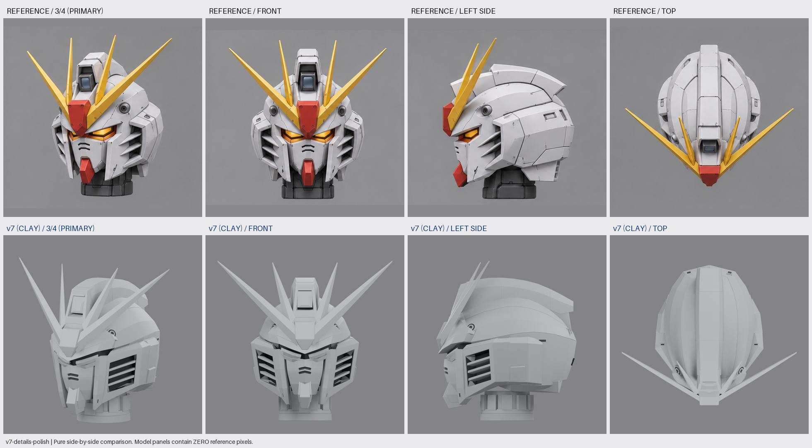

**2. 四视图分色对照**
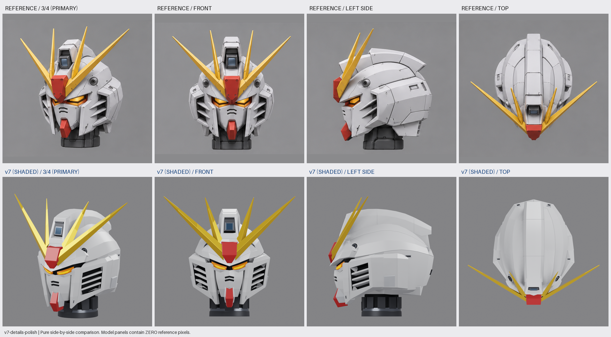

**3. 通风框、上肩小槽、前颊微槽与耳侧副甲局部特写（3/4 + 侧面 + 顶斜）**


**4. 后 3/4 与背面灰模对照**
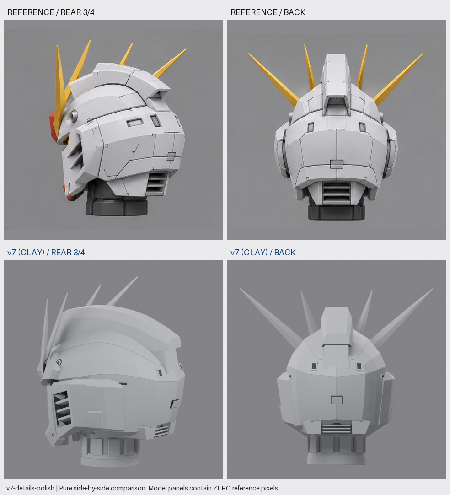

---

### 本版核心修正项
- **P0-1 发丝级 3D 物理分缝**：全部收细至约 `0.0050` 宽 U 型槽，槽壁恢复白色本色、仅极窄槽底柔和中灰（灰模纯靠实体凹槽与 GTAO 显影），去掉多余经纬网格线，并补齐**背面正中竖直分缝**与**顶冠 2 条细横缝**。
- **P0-2 次级凹槽表面精准贴合 + 消尖角**：通过 `BVHTree.find_nearest` 将后脑双小方凹槽、侧后方凹槽、通风框上肩小槽与下巴/颊甲微槽全部精准贴齐宿主外表面（100% 清晰可见）；修平 `RearNapeLintel` 两端消除排气口上方小尖角。
- **P1-1 / P1-2 / P2**：后脑中线锁块贴合曲率并配深一阶冷灰与细暗框；耳侧细缝移至 `LowerStepPlate` 后方不再横劈；小凹槽外框倒角降至 `0.0010` 消除 clamp；前额主镜调深为冷钢蓝玻璃质感；修复对比图标题重叠。

独立审计子代理正在对 `v7-details-polish` 进行阶段 3 最终复检，结果返回后我将第一时间汇报验收结论。

## [41] 助手（2026-11-25T02:24:41Z）

独立审计子代理已完成 **`v7-details-polish`** 的阶段 3 最终只读复检。

### 一、最终验收结论
**✅ 正式通过阶段 3 细节、物理分缝与材质细化验收（`P0 残留 = 0`、`P1 残留 = 0`），达到高还原度可交付水准。**

### 二、复检硬指标摘要（`.blend` 实测）
- **全量 68 个 Mesh 拓扑健康**：`非流形边 NM = 0`、`开放边界 BND = 0`、`孤立点/边 = 0`、`负体积/翻转法线 = 0`；原始网格零退化面/零短边。
- **物理分缝闭环**：粗黑经纬网格彻底消除，发丝级 U 型槽底改为柔和冷灰、槽壁恢复白色本色，并补齐背面正中竖直分缝。
- **次级凹槽与结构闭环**：全部 5 组次级凹槽/台阶件外表面 **100% 清晰可见、零浮空（`min_gap = 0.0000`）**；后脑排气横梁尖角已消除；后脑中线锁块冷灰层次与耳侧副甲独立清晰；前额蓝镜调深为冷钢蓝玻璃质感；对比图标题零重叠。
- **通风腔纯净度持续通过**：正侧 12×12 与 3/4 10×10 射线检测头壳/内构穿入均为 **0**。

---

### 三、下一步由你决定（未确认前暂不覆盖 canonical 文件或桌面窗口）
1. **在桌面 Blender 中打开 `v7-details-polish`**（[freedom-head-v2-v7-details-polish.blend](../v7-details-polish/freedom-head-v2-v7-details-polish.blend)）供你实转验收；
2. **将 `v7-details-polish` 提交到本地 Git**（含脚本与对比图更新）；
3. **导出 `GLB` 并更新仓库 canonical `freedom-head.blend` / `freedom-head.glb`**（导出前自动清理微米级 Bevel 合并点；仍暂不接入网页）。

请告诉我你想先执行哪几项，或者是否还有任何局部想继续微调的地方。

## [42] 用户（2026-11-25T02:34:10Z）

<USER_REQUEST>
先推送
</USER_REQUEST>
<ADDITIONAL_METADATA>
The current local time is: 2026-11-25T10:34:10+08:00.
</ADDITIONAL_METADATA>

## [43] 助手（2026-11-25T02:35:39Z）

已提交 `v7-details-polish` 及脚本更新，正在向 `origin/freedom-teardown` 推送（对象已打包发送完成，等待远端确认），结果出来后立即汇报。

## [44] 助手（2026-11-25T02:37:34Z）

`v7-details-polish` 已安全提交到本地分支 `freedom-teardown`（提交哈希 `1917d00`），但当前环境向 GitHub HTTPS 推送依然被远端超时断开：

```text
Writing objects: 100% (211/211), 70.93 MiB | 39.89 MiB/s, done.
error: RPC failed; HTTP 408 curl 22 The requested URL returned error: 408
send-pack: unexpected disconnect while reading sideband packet
fatal: the remote end hung up unexpectedly
```

### 当前本地待推送提交（共 7 个，均已安全提交）
- `1917d00` — `v7-details-polish`（阶段三细节与物理分缝审计通过）+ 更新后的 [freedom_head_v2.py](../../../../scripts/blender/freedom_head_v2.py) / [compare_v2.py](../../../../scripts/blender/compare_v2.py)
- `1ee8dca` — `v6-secondary-details`
- `61e7bad` — `v5-macro-final`
- `780f8cf` — `v4-p0-p1-fix`
- `5d87326` — `v3-shape-refine`
- `90c860e` — `v2-blockout`
- `2b5a057` — 脚本、参考裁图与 `v1-blockout`

请直接在你本机终端（或改用 SSH 远端后）执行推送：
```sh
git -C /Users/congt/workspace/octopus-teardown push origin freedom-teardown
```

需要我现在帮你把验收通过的 `v7-details-polish` 在桌面 Blender 中打开查看，或者导出 `GLB` 吗？

## [45] 用户（2026-11-25T02:34:50Z）

<USER_REQUEST>
我需要把这个会话放到项目里
</USER_REQUEST>
<ADDITIONAL_METADATA>
The current local time is: 2026-11-25T10:34:50+08:00.
</ADDITIONAL_METADATA>
